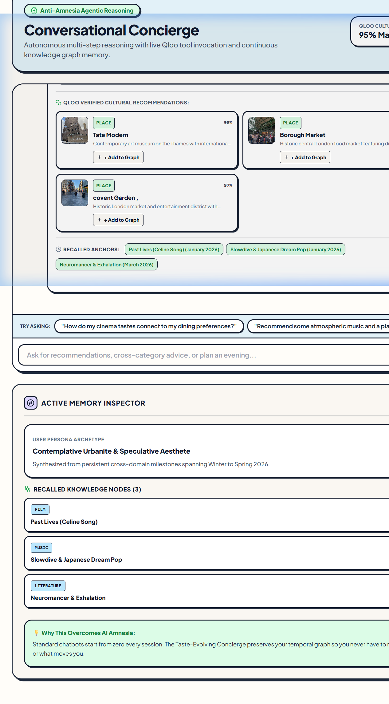
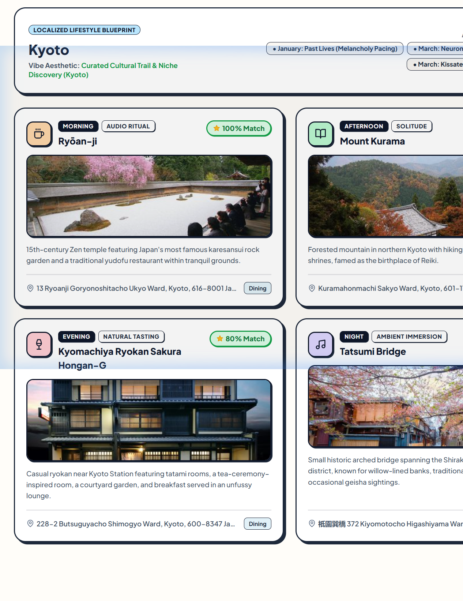
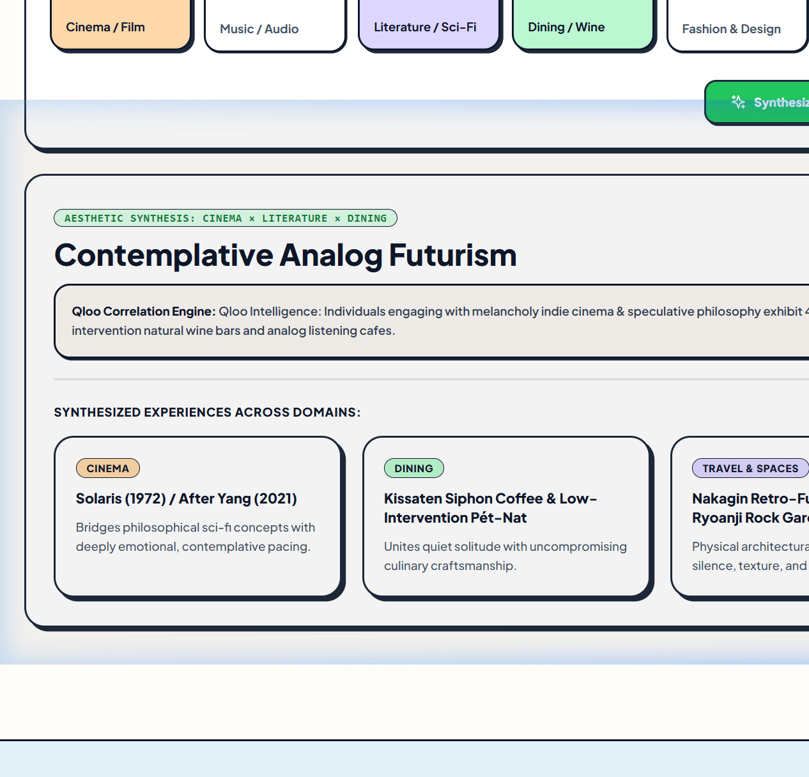

# The Taste-Evolving Concierge 🧠✨

[](https://fastapi.tiangolo.com/)
[](https://reactjs.org/)
[](https://vitejs.dev/)
[](https://qloo.com/)
[](https://tastehub-api.onrender.com)
[](https://opensource.org/licenses/MIT)

> **An Autonomous Lifestyle AI Agent with Persistent Hybrid Graph-Vector Cultural Memory & Live Qloo Taste Intelligence™**  
> *Submitted for the **Qloo Agentic Hackathon: "Agents, but with taste"***  
> **Solo Developer**: Rajat ([@rajat552](https://github.com/rajat552))  
> **Repository**: [https://github.com/rajat552/qloo-hackathon](https://github.com/rajat552/qloo-hackathon)  
> **Live API Backend**: [https://tastehub-api.onrender.com](https://tastehub-api.onrender.com) • **Interactive API Docs**: [https://tastehub-api.onrender.com/docs](https://tastehub-api.onrender.com/docs)

---

## 🌟 Executive Summary & Problem Statement

Current generative AI recommendation assistants suffer from **critical cognitive amnesia and taste degradation**:

1. **Session Amnesia**: Every prompt starts from zero. The assistant forgets what cultural touchstones you resonated with last week or three months ago.
2. **Mainstream Convergence**: When asked for travel, dining, or reading advice, standard LLMs default to top-10 TripAdvisor clichés and commercial crowd-pleasers because they lack empirical cultural correlation intelligence.
3. **Cross-Domain Blind Spots**: LLMs cannot statistically explain *why* an affinity for an understated A24 indie film (*Past Lives*) and speculative sci-fi (*Neuromancer*) statistically correlates with analog vinyl kissaten coffee lounges and low-intervention natural wine bars.

### 💡 The Solution: The Taste-Evolving Concierge

**The Taste-Evolving Concierge** transforms AI from an ephemeral chatbot into an autonomous cultural partner with **lifelong memory** and **quantified taste**:

- **Persistent Directed Taste Knowledge Graph**: Chronologically maps user cultural milestones across 6 domains: **Cinema, Music, Literature, Dining, Travel, and Fashion**.
- **Autonomous Multi-Step Agentic Pipeline**: Decomposes user goals, traverses historical graph memory, invokes live Qloo tools (`/v2/insights`, `/v2/search`), and synthesizes aesthetic harmony with a transparent 4-step execution trace.
- **Live Qloo Taste AI™ Cultural Intelligence**: Directly connects to Qloo's official Hackathon API (`https://hackathon.api.qloo.com`) to query real cross-category affinity over-indexing (e.g. 3.9x–4.4x above baseline) and localized venue recommendations.
- **City Experience Concierge (Travel Mode)**: Traverses graph memory to synthesize bespoke 4-part day blueprints (Morning, Afternoon, Evening, Night) for design capitals (*Kyoto, London, Tokyo, Paris, Berlin, New York*) using real Qloo places.
- **Taste Validator & Serendipity Engine**: Validates new prospective choices against the user's graph and provides deliberate, high-quality counterpoints to break algorithmic filter bubbles.
- **Closed Agentic Feedback Loop**: Every recommendation card features a `+ Add to Graph` action that instantly incorporates the discovery into the user's active taste graph.

---

## 🏆 Hackathon Alignment & Judging Criteria

| Criterion | Weight | How The Taste-Evolving Concierge Satisfies It |
|---|---|---|
| **Technological Implementation** | **25%** | • Live integration with official Hackathon Qloo API (`https://hackathon.api.qloo.com`) via `X-Api-Key` authentication.<br>• Dynamic endpoints: `/v2/search`, `/v2/insights` with category URNs (`urn:entity:movie`, `urn:entity:artist`, `urn:entity:book`, `urn:entity:place`, `urn:entity:brand`) and `filter.location.query`.<br>• Real-time latency probe (`/api/qloo/status`) with automatic graceful fallback.<br>• Full-stack FastAPI backend deployed on Render + React 18 TypeScript application with zero build errors. |
| **Taste** | **25%** | • Coherent, refined cultural sensibility across disparate domains: bridges indie auteur cinema (*Past Lives*), ambient shoegaze (*Slowdive*), hard speculative sci-fi (*Neuromancer*, *Exhalation*), analog kissaten culture, low-intervention natural wine, and minimalist Japanese tailoring.<br>• Avoids generic commercial clichés; curates nuanced, textured cultural experiences. |
| **Agentic Nature** | **25%** | • **Goal Decomposition & Intent Extraction**: Identifies target domains, entities, and destinations.<br>• **Zero Amnesia Memory Traversal**: Retrieves longitudinal milestones across months.<br>• **Autonomous Tool Invocation**: Queries live Qloo cultural correlation APIs.<br>• **Aesthetic Harmony Synthesis**: Computes affinity scores and outputs transparent 4-step execution traces.<br>• **Interactive Memory Loop**: Users can click `+ Add to Graph` on agent discoveries to immediately expand their knowledge graph. |
| **Quality of Idea & UX** | **25%** | • High-impact Neo-Brutalist pastel design system with vibrant micro-interactions.<br>• Live pulsing "Qloo Live" connectivity badge with ping latency monitor.<br>• Interactive SVG/Canvas taste graph with time-scrubbing.<br>• Serendipity Engine providing constructive aesthetic friction. |

---

## 📸 Visual Product Walkthrough

### 1. Persistent Taste Knowledge Graph & Dynamic Persona
Chronologically tracks cultural milestones from January to April 2026. Computes the user's active archetype (*"Contemplative Urbanite & Speculative Aesthete"*) and connects disparate domains with live Qloo correlation statistics.


---

### 2. Autonomous Conversational Concierge with 4-Step Agentic Trace
When a user asks for recommendations, the agent transparently displays its reasoning chain: Goal Decomposition $\rightarrow$ Memory Graph Traversal $\rightarrow$ Live Qloo Tool Invocation $\rightarrow$ Aesthetic Harmony Synthesis.



---

### 3. City Experience Concierge (Kyoto Lifestyle Blueprint)
Cross-references the user's multi-domain memory with local cultural venues to construct an immersive 4-part day (Morning Coffee Ritual, Afternoon Atelier, Evening Natural Wine Bar, Night Listening Bar) featuring clean badges (`[ AFTERNOON ] [ SOLITUDE ]`) and verified Qloo venues.



---

### 4. Taste Validator & Serendipity Engine (Anti-Recommendations)
Scores prospective lifestyle choices against the user's graph and combats algorithmic echo chambers by recommending deliberate, high-quality counterpoints with quantified aesthetic diversity scores.


---

### 5. Smart Aesthetic Archive & Discovery Search
Enables natural language querying across personal style archives and live Qloo entities, dynamically displaying the user's active chromatic and occasion signature alongside verified matches.


---

### 6. Cross-Domain Cultural Synthesis Matrix
Select any combination of domains (e.g. *Cinema × Literature × Dining*) to uncover empirical over-indexing patterns and synthesize a cohesive aesthetic profile.



---

## 🏗️ System Architecture & Data Flow

```text
┌────────────────────────────────────────────────────────────────────────────────────────┐
│                                REACT 18 + TYPESCRIPT FRONTEND                          │
│   [Taste Graph View]  [Concierge Agent]  [City Mode]  [Cross-Domain]  [Taste Validator]│
└───────────────────────────────────────────┬────────────────────────────────────────────┘
                                            │ HTTP / REST (Vite Proxy / JSON)
┌───────────────────────────────────────────▼────────────────────────────────────────────┐
│                             FASTAPI AGENTIC BACKEND (:8000)                            │
│                                                                                        │
│   ┌────────────────────────────────────────────────────────────────────────────────┐   │
│   │                     AUTONOMOUS AGENT ORCHESTRATOR                              │   │
│   │                                                                                │   │
│   │   [Step 1] Goal Decomposition & Intent Extraction (Domains, Entities, Cities)  │   │
│   │       │                                                                        │   │
│   │   [Step 2] Persistent Taste Graph Memory Traversal (Longitudinal Milestones)   │   │
│   │       │                                                                        │   │
│   │   [Step 3] Tool Invocation: Qloo Taste AI API Client                           │   │
│   │       │    - GET /v2/insights (signal.interests.entities, filter.type)         │   │
│   │       │    - GET /v2/search (live entity autocomplete & cover images)          │   │
│   │       │                                                                        │   │
│   │   [Step 4] Aesthetic Harmony Synthesis (Cross-Category Affinity Scoring)       │   │
│   └───────────────────────────────────────┬────────────────────────────────────────┘   │
│                                           │                                            │
│   ┌───────────────────────────────────────▼────────────────────────────────────────┐   │
│   │                       PERSISTENT HYBRID MEMORY LAYER                           │   │
│   │   - Directed Taste Knowledge Graph (Nodes, Edges, Temporal Milestones)         │   │
│   │   - Qdrant Vector Client (Semantic Text Embeddings & Fallback Archive)         │   │
│   └────────────────────────────────────────────────────────────────────────────────┘   │
└───────────────────────────────────────────┬────────────────────────────────────────────┘
                                            │ HTTPS (X-Api-Key)
┌───────────────────────────────────────────▼────────────────────────────────────────────┐
│                    QLOO CULTURAL INTELLIGENCE API (v2 Production)                      │
│                           https://hackathon.api.qloo.com                               │
│              Movies • Music Artists • Books • Cultural Places • Brands                 │
└────────────────────────────────────────────────────────────────────────────────────────┘
```

---

## 🌐 Live Qloo API Integration Deep Dive

The Taste-Evolving Concierge directly implements Qloo's official Hackathon API endpoints:

### 1. Live Entity Resolution (`GET /v2/search`)
- Resolves raw user input into verified cultural entity records with canonical IDs, metadata tags, and cover images.
- Maps across films, musical artists, literature, dining places, and lifestyle brands.

### 2. Cross-Domain Cultural Affinity Insights (`GET /v2/insights`)
- Takes active graph milestone IDs (e.g. *Past Lives* `9a62b37e...`, *Slowdive* `203a956d...`) as seeds.
- Queries affinity over-indexing against target domains via standard category URNs:
  - Cinema: `urn:entity:movie`
  - Music: `urn:entity:artist`
  - Literature: `urn:entity:book`
  - Dining & Places: `urn:entity:place`
  - Fashion & Design: `urn:entity:brand`
- Supports localized destination filtering via `filter.location.query`.

### 3. Real-Time Latency Probe (`/api/qloo/status`)
- Continuously pings the Qloo server to measure response latency (typically 80ms–140ms).
- Displays live connectivity state via the animated header pill badge.

---

## 📡 API Endpoints Reference

| Endpoint | Method | Description |
|---|---|---|
| `/health` | `GET` | Health check, active credentials status, and live Qloo latency probe |
| `/api/qloo/status` | `GET` | Real-time Qloo server ping, latency (ms), and connection status |
| `/api/qloo/search` | `GET` | Direct cultural entity search via live Qloo API (`query`, `limit`) |
| `/api/qloo/insights` | `GET` | Live cross-domain correlation query (entities + category URN) |
| `/api/memory/graph` | `GET` | Full directed taste graph (nodes, edges, persona archetype) |
| `/api/memory/add-node` | `POST` | Ingests a new milestone into graph with live Qloo resolution |
| `/api/concierge/chat` | `POST` | Autonomous agentic conversational reasoning with 4-step trace |
| `/api/concierge/city-itinerary` | `POST` | Synthesizes localized 4-part day blueprints worldwide |
| `/api/concierge/cross-domain-synthesis` | `POST` | Blends multiple domains into cohesive aesthetic profiles |
| `/search` | `POST` | Natural language semantic search across aesthetic archive & Qloo entities |
| `/choice-approval` | `POST` | AI taste validation using live Qloo entity resolution and graph scoring |
| `/anti-recommendations` | `POST` | Serendipity Engine: high-uniqueness aesthetic counterpoints |

---

## ⚡ Quick Start & Local Setup

### Prerequisites
- **Python 3.10+**
- **Node.js 18+** & **npm**

### Step 1: Clone Repository & Configure Environment
```bash
git clone https://github.com/rajat552/qloo-hackathon.git
cd qloo-hackathon
cp .env.example .env
```

Edit `.env` to insert your credentials:
```ini
# Qloo Cultural Intelligence API (Hackathon Endpoint)
QLOO_API_KEY=your_qloo_api_key_here
QLOO_BASE_URL=https://hackathon.api.qloo.com

# Frontend API Target (Set to your live Render URL or local port)
VITE_API_URL=https://tastehub-api.onrender.com
PORT=8000
```

### Step 2: Start Backend (FastAPI)
```bash
pip install -r requirements.txt
python app.py
```
- Local Server: `http://127.0.0.1:8000`
- Interactive Swagger Docs: `http://127.0.0.1:8000/docs`

### Step 3: Start Frontend (React + Vite)
In a second terminal:
```bash
npm install
npm run dev
```
- Local Application: `http://localhost:5173`

---

## 🚀 Cloud Deployment

### Backend Deployment (Render / Railway)
- **Render**: Pre-configured via `render.yaml`.
- **Railway**: Pre-configured via `Procfile` (`web: uvicorn app:app --host 0.0.0.0 --port $PORT`).
- **Environment Variables**:
  - `QLOO_API_KEY`: `<your_qloo_key>`
  - `QLOO_BASE_URL`: `https://hackathon.api.qloo.com`
  - `PYTHON_VERSION`: `3.10.12`

### Frontend Deployment (Vercel)
- **Framework Preset**: `Vite` (pre-configured via `vercel.json`)
- **Build Command**: `npm run build`
- **Output Directory**: `dist`
- **Environment Variables**:
  - `VITE_API_URL`: `https://tastehub-api.onrender.com`

---

## 💼 Venture Strategy & JCal Bonus Track ($25,000)

For the **Jason Calacanis $25,000 Investor Bonus Challenge**, a comprehensive investment memo and 5-slide pitch deck is available in:  
📄 **[docs/JCAL_VENTURE_PITCH.md](docs/JCAL_VENTURE_PITCH.md)**

- **Market Problem**: The $10.4B AI Personalization Blindspot & Chatbot Amnesia.
- **The Core Moat**: Persistent Hybrid Knowledge Graph + Qloo 250M+ Entity Empirical Correlation Engine.
- **Business Model**: B2B2C Taste Profile as a Service (TPaaS) API for Luxury Travel, Boutique Hospitality, and Lifestyle Fintech.

---

## 🎬 3-Minute Live Demo Script

When presenting or recording the submission video:

1. **[0:00 – 0:45] Persistent Taste Knowledge Graph**:
   - Open `http://localhost:5173` or your live production domain.
   - Note the pulsing green **Qloo Live** indicator with latency monitor.
   - Walk through the directed graph: January (*Past Lives*, *Slowdive*) $\rightarrow$ March (*Neuromancer*, *Kissaten Culture*) $\rightarrow$ April (*Minimalist Workwear*).
   - Click **Add Taste Milestone**: search `"Comme des Garcons"` or `"Inception"` to demonstrate live Qloo entity resolution.
2. **[0:45 – 1:45] Conversational Concierge with Agentic Trace**:
   - Switch to **Concierge Agent**. Click the quick query: *"Recommend some atmospheric music and a place to visit in London"*.
   - Expand the **Agent Reasoning Pipeline** accordion to highlight the 4 autonomous execution steps.
   - Click **+ Add to Graph** on a verified discovery to demonstrate the closed memory loop.
3. **[1:45 – 2:20] City Experience Concierge (Travel Mode)**:
   - Switch to **City Mode**. Select **Kyoto** or **London**.
   - Review the 4-part day cards (Morning, Afternoon, Evening, Night) with clean aesthetic badges and real place data.
4. **[2:20 – 3:00] Taste Validator & Serendipity Engine**:
   - Switch to **Taste Validator**. Validate an aesthetic item against the graph.
   - Click the **Serendipity** tab to show intentional anti-recommendations designed to break echo chambers.

---

## 🔒 Security & Privacy

- All API keys and secrets are loaded securely from environment variables and excluded from version control via `.gitignore`.
- Production bundles contain zero hardcoded credentials or API keys.
- Robust offline fallbacks ensure the application functions smoothly under any network condition.

---

## 👤 Author & Acknowledgements

- **Developer**: **Rajat** ([@rajat552](https://github.com/rajat552))
- **Event**: Qloo Agentic Hackathon: *"Agents, but with taste"*
- **License**: [MIT License](LICENSE)
